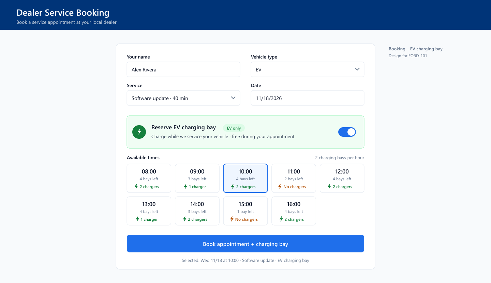

# Figma frame spec · "Booking – EV charging bay"

This is the design for Jira story **FORD-101** (use the actual imported Jira key). Read the live frame through the **Figma connector** when available; otherwise use this specification and the committed PNG as the explicitly labeled design fallback.

## Set up the frame in Figma (about 10 minutes)

1. In Figma, create a design file called **Ford Dealer Service Booking**.
2. Do one of the following:
   - **Quick:** drag `booking-ev-slot.png` onto the canvas. Select it, then choose **Frame selection** (Ctrl+Alt+G). Rename the frame exactly **`Booking – EV charging bay`**.
   - **Better:** rebuild the frame with real layers using the spec below. Copilot can read layer names, text and colors from real layers, but only the image from a pasted PNG.
3. Share the file with the Figma account you sign in with in the Copilot app connector.
4. Copy the frame link: right-click the frame → **Copy link to selection**. Keep it in your notes as a backup for the demo prompt.

> Tip: name your layers as shown below (`ev-charging-panel`, `slot-card`, and so on). Copilot follows them more closely.

## Layout

| Element | Spec |
|---|---|
| Frame | 1440 × 832, background `#F8FAFC` |
| Header (`header`) | Full width, 88 high, fill `#003478`. Title "Dealer Service Booking" (26, Semibold, white). Subtitle "Book a service appointment at your local dealer" (14, `#CBD5E1`) |
| Card (`booking-card`) | x 340, y 128, 760 × 664, white, 1 px `#E2E8F0` border, radius 12, padding 32 |
| Form fields | 2 columns, 32 gap. Label 14 Semibold `#0F172A`. Input 44 high, radius 6, 1 px `#E2E8F0` border |
| EV panel (`ev-charging-panel`) | Full card width, 96 high, fill `#F0FDF4`, 1 px `#86EFAC` border, radius 8 |
| Slot grid (`slot-grid`) | 5 columns, 12 gap. Each `slot-card` is 84 high with radius 8 |
| Button (`book-button`) | Full width, 52 high, fill `#1F6FEB`, radius 8. Label 16 Semibold white |

## Colors

| Token | Hex | Used for |
|---|---|---|
| Brand navy | `#003478` | Header |
| Action blue | `#1F6FEB` | Button, toggle on, selected slot border |
| Selected slot fill | `#EFF6FF` | Selected slot |
| EV green | `#15803D` | Charger counts, EV icon, "EV only" tag text |
| EV panel fill / border | `#F0FDF4` / `#86EFAC` | EV panel |
| Warning amber | `#B45309` | "No chargers" |
| Ink / body / muted | `#0F172A` / `#334155` / `#64748B` | Text |
| Border | `#E2E8F0` | Inputs and cards |

Font: Segoe UI (Figma fallback: Inter).

## Copy

- Panel title: **Reserve EV charging bay**
- Tag: **EV only**
- Panel text: **Charge while we service your vehicle · free during your appointment**
- Grid caption: **2 charging bays per hour**
- Slot lines: `HH:00`, `N bays left` (or `1 bay left`), and `⚡ N chargers`, `⚡ 1 charger` or `⚡ No chargers`
- Button (charging on): **Book appointment + charging bay**. Button (charging off): **Book appointment**
- Summary under button: **Selected: Wed 11/18 at 10:00 · Software update · EV charging bay**

## States and behavior

| State | Behavior |
|---|---|
| Vehicle type is Gas or Hybrid | The EV panel is **hidden**. Slots show bays only, with no charger line |
| Vehicle type is EV, toggle off | The EV panel is visible. Slots show charger counts. The button reads "Book appointment" |
| Vehicle type is EV, toggle on | Slots with no chargers are **disabled** (greyed, not selectable). The button reads "Book appointment + charging bay" |
| Selected slot | `#EFF6FF` fill and 2 px `#1F6FEB` border |
| No chargers | Amber bolt and the text "No chargers" |
| Booking confirmed | Message: "Booked! Confirmation #12 — 2026-11-18 at 10:00. EV charging bay reserved." |

Sample data shown in the mock (chargers left per hour, 08:00–16:00): `2, 1, 2, 0, 2, 1, 2, 0, 2`. Bays left: `4, 3, 4, 2, 4, 4, 3, 1, 4`.

## Maintained design asset

The committed PNG is the ready-to-use demo mock; no generator or deck dependencies are required. If the design changes, update this specification and export a replacement PNG from the Figma frame. The sample date and confirmation number are illustrative; use a future non-Sunday date in the live demo.
